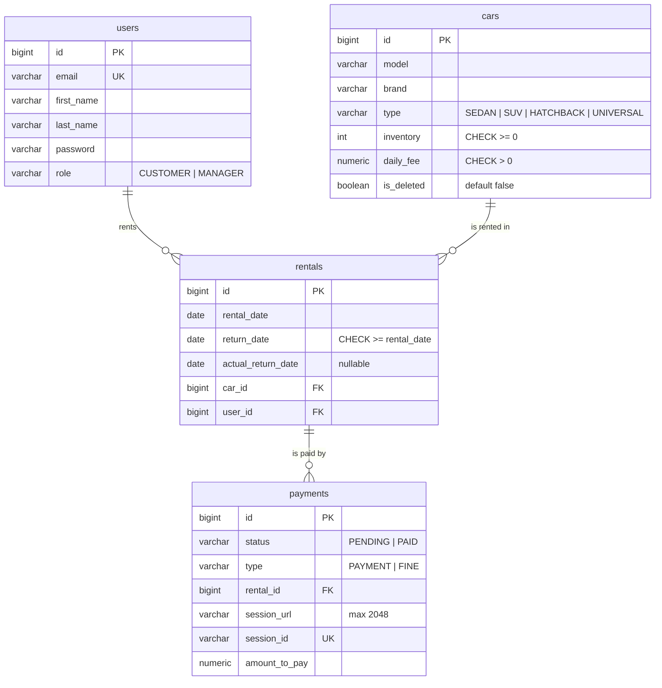

# Car Sharing Service

A REST API for managing an online car rental service. Managers maintain the car catalog,
customers rent cars and return them, rentals are paid through Stripe Checkout, and a
Telegram chat receives notifications about new and overdue rentals. The API is secured with
JWT and documented with OpenAPI / Swagger UI.

## Features

**Authentication & roles**
- Registration (new users always get the `CUSTOMER` role) and login that returns a JWT.
- Two roles: `CUSTOMER` and `MANAGER`; managers can change any user's role.
- Stateless security; `401` / `403` responses are JSON with `timestamp` and `error`.

**Cars**
- Public, paginated car catalog and car details.
- Managers create, update and delete cars; deletion is a soft delete (`is_deleted` flag).

**Rentals**
- Customers rent a car by ID and a return date; car inventory is decreased by one.
- Returning a rental sets the actual return date and puts the car back into inventory.
- Filtering by `user_id` (managers only) and `is_active` (returned / not returned).

**Payments with Stripe**
- Stripe Checkout sessions for two payment types: `PAYMENT` (the rental itself) and
  `FINE` (late return).
- Success and cancel redirect endpoints; success verifies the session with Stripe before
  marking the payment `PAID`.

**Telegram notifications**
- A message is sent to a Telegram chat whenever a rental is created.
- Notifications can be turned off with `TELEGRAM_ENABLED=false`.

**Daily overdue check**
- A scheduled job (default: every day at 09:00, Europe/Kyiv) sends a message for each
  overdue rental, or "No rentals overdue today!" when there are none.

## Tech stack

| Area | Technologies |
|---|---|
| Language & framework | Java 21, Spring Boot 4 (Web MVC, Data JPA, Security, Validation) |
| Security | Spring Security, JWT (jjwt 0.13) |
| Database | PostgreSQL, Liquibase |
| Mapping & boilerplate | MapStruct, Lombok |
| Integrations | Stripe Java SDK, Telegram Bot API (Spring `RestClient`) |
| API docs | springdoc OpenAPI (Swagger UI) |
| Containers | Docker, Docker Compose |
| Testing | JUnit 5, Mockito, Spring Security Test, MockMvc, Testcontainers, JaCoCo |
| Code quality & CI | Checkstyle, GitHub Actions |

## Domain model

Tables are created by the Liquibase changelogs in `src/main/resources/db/changelog`.



## API endpoints

All paths start with the `/api` context path. List endpoints are paginated with the standard
`page`, `size` and `sort` query parameters.

Access levels:
- **Public**: no token needed.
- **Authenticated**: any logged-in user. Customers only see their own data; managers see everything.
- **Manager**: `MANAGER` role only.

### Authentication

| Method | Path | Access | Description |
|---|---|---|---|
| POST | `/api/register` | Public | Register a new customer |
| POST | `/api/login` | Public | Log in and receive a JWT (`{"token": "..."}`) |

### Users

| Method | Path | Access | Description |
|---|---|---|---|
| GET | `/api/users/me` | Authenticated | Get my profile |
| PUT | `/api/users/me` | Authenticated | Update my first and last name |
| PUT | `/api/users/{id}/role` | Manager | Change a user's role |

### Cars

| Method | Path | Access | Description |
|---|---|---|---|
| GET | `/api/cars` | Public | Paginated list of cars (soft-deleted cars are hidden) |
| GET | `/api/cars/{id}` | Public | Car details |
| POST | `/api/cars` | Manager | Create a car |
| PUT | `/api/cars/{id}` | Manager | Update a car |
| DELETE | `/api/cars/{id}` | Manager | Soft-delete a car |

### Rentals

| Method | Path | Access | Description |
|---|---|---|---|
| POST | `/api/rentals` | Authenticated | Rent a car (`carId`, `returnDate`) |
| GET | `/api/rentals?user_id=&is_active=` | Authenticated | Rentals list; `is_active=true` means not returned yet; `user_id` is manager-only |
| GET | `/api/rentals/{id}` | Authenticated (owner or manager) | Rental details |
| POST | `/api/rentals/{id}/return` | Authenticated (owner or manager) | Return a rental |

### Payments

| Method | Path | Access | Description |
|---|---|---|---|
| GET | `/api/payments?user_id=` | Authenticated | Payments list; `user_id` is manager-only |
| POST | `/api/payments` | Authenticated (rental owner or manager) | Create a Stripe Checkout session (`rentalId`, `type`: `PAYMENT` / `FINE`) |
| GET | `/api/payments/success?session_id=` | Public | Stripe success redirect; verifies the session and marks the payment `PAID` |
| GET | `/api/payments/cancel?session_id=` | Public | Stripe cancel redirect; returns a message and the session URL to retry |

### Health

| Method | Path | Access | Description |
|---|---|---|---|
| GET | `/api/health` | Public | Returns `{"status": "UP", ...}` |

Error responses from the application contain a `timestamp` and an `error` message.
Validation errors return `400` with per-field messages under `errors`.

## Business rules

- **Inventory:** a car can be rented only while its inventory is above zero; otherwise the
  request gets `409`. The car row is locked with a pessimistic write lock while it is rented
  or returned, so concurrent requests cannot oversell the last car.
- **Rental date** is set on the server to today. The return date must be in the future.
- **Returns:** a rental can be returned only once; a second return gets `409`. Returning
  sets `actual_return_date` to today and increases the car's inventory.
- **Visibility:** customers see and act only on their own rentals and payments. Using the
  `user_id` filter or touching someone else's rental returns `403`.
- **`PAYMENT` amount** is the number of rental days (from rental date to return date, at
  least 1) × the daily fee.
- **`FINE` amount** is the number of overdue days (from return date to actual return date)
  × the daily fee × `FINE_MULTIPLIER`. A fine is allowed only for rentals returned after
  their return date; otherwise the request gets `409`.
- **Session reuse:** if a `PENDING` payment of the same type already exists for the rental,
  its Stripe session is returned instead of creating a new one. If it is already `PAID`, the
  request gets `409 "Payment is already completed"`.
- **Success check:** `/payments/success` asks Stripe whether the session is paid before
  marking the payment `PAID`. The endpoint is idempotent for already-paid payments.
  Success and cancel are public because Stripe redirects the browser there without a JWT.
- **Overdue check:** a rental is reported when its return date is tomorrow or earlier and it
  has not been returned.

## Getting started

### Prerequisites

- Java 21 (only needed to build and test locally)
- Docker with Docker Compose

### 1. Clone and configure

```bash
git clone https://github.com/Misanthrope88/car-sharing-service.git
cd car-sharing-service
cp .env.sample .env
```

Fill in `.env`. Never commit it.

| Variable | Required | Default | Description |
|---|---|---|---|
| `POSTGRES_DB` | yes | `car_sharing` (in `.env.sample`) | Database name |
| `POSTGRES_USER` | yes | — | Database user |
| `POSTGRES_PASSWORD` | yes | — | Database password |
| `POSTGRES_LOCAL_PORT` | no | `5433` | Host port mapped to PostgreSQL |
| `APP_LOCAL_PORT` | no | `8080` | Host port mapped to the application |
| `JWT_SECRET` | yes | — | JWT signing secret, at least 32 characters |
| `JWT_EXPIRATION_MS` | no | `3600000` | Token lifetime in milliseconds (1 hour) |
| `TELEGRAM_ENABLED` | no | `false` | Turns Telegram notifications on |
| `TELEGRAM_BOT_TOKEN` | if Telegram is enabled | — | Bot token from @BotFather |
| `TELEGRAM_CHAT_ID` | if Telegram is enabled | — | Target chat ID |
| `OVERDUE_CHECK_CRON` | no | `0 0 9 * * *` | Spring cron expression for the overdue check |
| `OVERDUE_CHECK_ZONE` | no | `Europe/Kyiv` | Time zone for the cron expression |
| `FINE_MULTIPLIER` | no | `1.5` | Multiplier applied to fines |
| `STRIPE_SECRET_KEY` | yes, for payments | — | Stripe secret key (use a `sk_test_...` key) |
| `STRIPE_CURRENCY` | no | `usd` | Checkout currency |

### 2. Run

```bash
docker compose up --build
```

- API: http://localhost:8080/api
- Swagger UI: http://localhost:8080/api/swagger-ui/index.html
- Health check: http://localhost:8080/api/health
- PostgreSQL: `localhost:5433`

Liquibase creates the schema and a default manager on first start:

| Email | Password | Role |
|---|---|---|
| `manager@carsharing.com` | `Manager12345` | MANAGER |

### 3. First steps in Swagger UI

1. Call `POST /login` with the manager credentials and copy the `token`.
2. Click **Authorize** and paste the token **without** the `Bearer` prefix.
3. Create a car with `POST /cars`.
4. Register a customer with `POST /register`, log in as that customer and authorize again
   with the new token.
5. Rent the car with `POST /rentals` (`carId` plus a future `returnDate`).
6. Create a payment with `POST /payments` (`rentalId`, `"type": "PAYMENT"`) and open the
   returned `sessionUrl` in a browser.
7. Pay with the Stripe test card `4242 4242 4242 4242`, any future expiry date and any CVC.
   Stripe redirects to `/api/payments/success`, which marks the payment `PAID`.

## Telegram setup

1. In Telegram, open **@BotFather**, send `/newbot` and copy the bot token.
2. Send `/start` to the bot in a private chat, **or** add the bot to a group and send
   `/start@<bot_username>` there (because of privacy mode, the bot does not see ordinary
   group messages, and `getUpdates` would stay empty).
3. Open `https://api.telegram.org/bot<TOKEN>/getUpdates` in a browser and find
   `message.chat.id` (your user ID for a private chat; group IDs are negative,
   e.g. `-1001234567890`). Do not use the bot's own ID (the number before `:` in the token).
4. Set the variables in `.env`:
   ```
   TELEGRAM_ENABLED=true
   TELEGRAM_BOT_TOKEN=<token>
   TELEGRAM_CHAT_ID=<chat id>
   ```
5. Recreate the app container so it picks up the new values:
   `docker compose up -d --force-recreate app`. Creating a rental now posts
   "New rental created" to the chat.

## Testing

```bash
./mvnw clean verify
```

Docker must be running, because repository and controller tests start PostgreSQL with
Testcontainers.

- **Unit tests** (JUnit 5 + Mockito): services, payment amount calculators, notification
  message building and the scheduler, Telegram client, JWT utility and validators.
- **Repository tests** (`@DataJpaTest` + Testcontainers PostgreSQL): custom queries and
  locking queries against the real schema migrated by Liquibase.
- **Controller tests** (`@SpringBootTest` + MockMvc + Testcontainers): full HTTP flow with
  security and the database. Stripe and Telegram are replaced with mocks.

JaCoCo writes the coverage report to `target/site/jacoco/index.html`. The build fails if
line coverage drops below **60%** (DTOs, entities, generated mappers and the main class are
excluded). Checkstyle runs during the build, and GitHub Actions runs `mvn verify` on every
push and pull request.

## Project structure

```
src/main/java/mate/academy/carsharingservice
├── config        # Security filter chain, OpenAPI (JWT bearer scheme)
├── controller    # REST controllers: auth, users, cars, rentals, payments, health
├── dto           # Request/response records with validation
├── exception     # Custom exceptions and the global exception handler
├── mapper        # MapStruct mappers between entities and DTOs
├── model         # JPA entities and enums (Role, CarType, PaymentStatus, PaymentType)
├── repository    # Spring Data JPA repositories, including locking queries
├── security      # JWT utility and authentication filter
├── service       # Service interfaces
│   ├── impl          # Business logic for users, cars, rentals, payments, Stripe
│   ├── notification  # Telegram client, message builder, overdue-rental scheduler
│   └── payment       # Payment amount calculators (Strategy) and their provider
└── validation    # @FieldMatch constraint for password confirmation
```

## Challenges & solutions

- **Race conditions on car inventory.** Two customers renting the last car at the same time
  could drive inventory below zero. The car is loaded with a `PESSIMISTIC_WRITE` lock
  (`SELECT ... FOR UPDATE`) before inventory is checked and changed. The database also has
  a `CHECK (inventory >= 0)` constraint as a safety net.
- **Returning a car that was soft-deleted during the rental.** The normal lookup ignores
  deleted cars, so the return would fail with `404`. Returns use a separate lock query
  without the `is_deleted` filter, so the inventory is restored anyway.
- **Stripe success URL placeholder.** Stripe replaces `{CHECKOUT_SESSION_ID}` only when it
  appears literally. The success/cancel URLs are built with `ServletUriComponentsBuilder`
  and `build().toUriString()` without `encode()`, so the braces are not percent-encoded.
- **Telegram failures and secret leaks.** A slow or failing Telegram API must not break
  rental creation, and the bot token is part of the request URL. The client uses
  connect/read timeouts (3 s / 5 s), catches `RestClientException` and logs only the
  exception type, never the URL or the message.
- **Different amount rules per payment type.** Each `PaymentType` has its own
  `PaymentAmountCalculator` (Strategy pattern). `PaymentAmountCalculatorProvider` collects
  them into an `EnumMap`, so adding a new type does not touch the payment service.

## Author

Author: [Misanthrope88](https://github.com/Misanthrope88)
